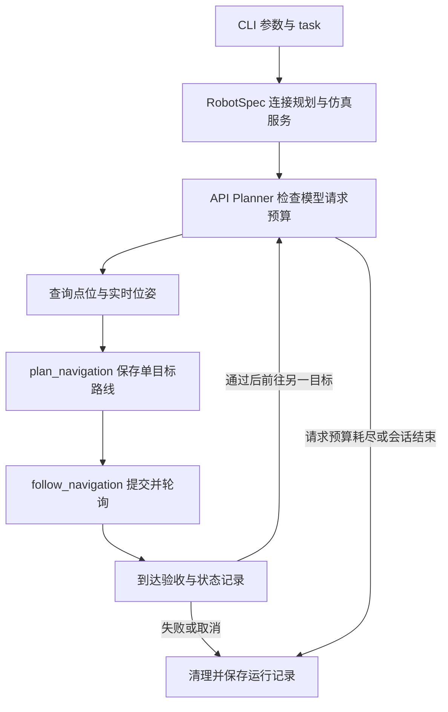

# MuJoCo 两点往返使用指南

本文说明如何让 Go2 先到广告牌，再到厕所通道，随后在两点之间持续往返，由 `--max-turns` 限制本次会话的模型请求次数。正常到达一个点后继续前往另一个点；预算耗尽、执行失败、超时或人工取消时结束会话。

导航和仿真在外部服务器运行，RPent 负责调用服务、等待行走结果并验收到达。网关模式见 [Unitree 接入说明](README.zh-CN.md)，外部 A* 服务的部署和接口示例见 [导航服务参考](NAVIGATION.zh-CN.md)。

## 1. 准备客户端与模型

需要 Python 3.10～3.12，以及能够调用工具的模型 API。在带 TTY 的普通终端中，从 RPent 仓库根目录执行；以下路径按本地实际目录修改：

```bash
cd /home/yanlinjie/rpent/RPent
python3 -m venv .venv
source .venv/bin/activate
python -m pip install -e .
```

已有环境时，直接激活该环境即可。客户端安装基础依赖即可，MuJoCo 和运动控制程序由服务端提供。

在运行 `rpent` 的同一个终端设置三个变量：

```bash
export RPENT_NAV_ENDPOINT='http://192.168.104.191:8765'
export RPENT_SIM_ENDPOINT='http://192.168.104.191:8770'
export RPENT_MODEL='openai:deepseek-flash'
```

两个地址是示例服务地址，应替换为实际可达地址。`RPENT_MODEL` 必须使用你的模型服务实际支持的名称。上面的模型名沿用调用示例；支持 Chat Completions 的服务使用 `openai-chat:模型名`，支持 Responses 的服务使用 `openai:模型名`。

`openai:` 和 `openai-chat:` 都通过以下变量配置认证及模型服务地址。已有可用配置时直接沿用；下列值为占位符，需要替换：

```bash
export OPENAI_API_KEY='YOUR_API_KEY'
export OPENAI_BASE_URL='https://your-model-service.example/v1'
rpent-check-llm --planner api --model "$RPENT_MODEL"
```

检查通过说明模型服务的连接和认证可用，实际工具调用还需要模型支持本任务的工具参数。模型配置详见 [规划器配置](../../docs/source-zh/rst_source/guides/configure_planner.rst)。

## 2. 检查规划服务和仿真器

先查询服务、点位和位姿：

```bash
curl --noproxy '*' "$RPENT_NAV_ENDPOINT/health"
curl --noproxy '*' "$RPENT_SIM_ENDPOINT/health"
curl --noproxy '*' "$RPENT_NAV_ENDPOINT/waypoints"
```

运行前核对以下条件：

| 检查项 | 预期结果 |
| --- | --- |
| 两个 `/health` | `ok: true`，且 `map_id`、`map_version` 相同 |
| 仿真服务 `simulator_running` | `true` |
| 仿真服务 `other_controllers` | 空列表或无活动控制器 |
| 仿真服务 `walk.state` | 没有正在执行的行走任务 |
| 点位列表 | 包含实际要访问的“广告牌”和“厕所通道” |
| 仿真位姿 | 返回有限的 `x`、`y`、`yaw`，且 `fallen: false` |

如果仿真控制 HTTP 服务已运行，而 `simulator_running` 为 `false`，在提供该运维接口的部署中可以启动仿真器：

```bash
curl --noproxy '*' -X POST "$RPENT_SIM_ENDPOINT/simulator/start"
```

启动后重新检查服务和位姿：

```bash
curl --noproxy '*' "$RPENT_SIM_ENDPOINT/health"
curl --noproxy '*' "$RPENT_SIM_ENDPOINT/pose"
```

仿真窗口显示在服务端电脑的桌面上。RPent Toolkit 会使用已经启动的仿真器；`/simulator/start` 属于外部服务的运维接口，不是 Planner 工具。若服务无法连接或启动失败，需要先在服务器上处理服务进程、图形环境或地图加载问题。

一个仿真端点同时交给一个 RPent 进程使用。点位编号和坐标以 `/waypoints` 当前返回为准，地图更新后需重新查询。

## 3. 运行持续往返任务

为每次运行创建独立输出目录，便于区分状态文件、transcript 和路线报告：

```bash
export RPENT_RUN_DIR="./logs/mujoco-navigation-$(date +%Y%m%d-%H%M%S)"
```

下面保留 `300` 秒单次导航预算、`900` 秒 Planner 总预算和 `16` 次模型请求上限。任务中明确要求正常到达后继续往返，由程序预算结束会话，避免把“来回走”理解为自行选择有限次数后结束：

```bash
rpent --robot unitree --unitree-mode mujoco \
  --nav-endpoint "$RPENT_NAV_ENDPOINT" \
  --sim-endpoint "$RPENT_SIM_ENDPOINT" \
  --planner api --model "$RPENT_MODEL" \
  --task '先去广告牌，确认到达后，再去厕所通道。之后在两个地点之间持续来回走，每次确认到达后再前往另一个地点。正常到达后继续执行，不主动结束任务，由程序在达到max-turns时停止；失败或超时则结束并报告。' \
  --navigation-timeout-s 300 \
  --planner-timeout-s 900 \
  --max-turns 16 \
  --output-dir "$RPENT_RUN_DIR"
```

访问顺序为：

```text
当前位置 → 广告牌 → 厕所通道 → 广告牌 → 厕所通道 → ……
```

这是一段由 Planner 持续选择下一目标的会话。每次离开当前点，都需要从实时位姿重新规划单目标路线，获得新的 `plan_id`，再调用 `follow_navigation`。已经完成的 `plan_id` 不能重复执行。

如果沿用 `--output-dir ./logs/mujoco-navigation`，目录非空时 CLI 会提示文件可能覆盖；`states.json` 会记录新一轮状态，旧 transcript 和路线文件可能仍保留。独立目录可以避免分析时混入以前的运行记录。

## 4. 理解三个运行预算

| 参数 | 本例取值 | 实际含义 |
| --- | --- | --- |
| `--navigation-timeout-s` | `300` | 每次 `follow_navigation` 或独立预演的预算，单位秒 |
| `--planner-timeout-s` | `900` | 整个 Planner 会话的预算，包含模型调用和等待工具执行，单位秒 |
| `--max-turns` | `16` | API Planner 最多发起 16 次模型请求 |

`--max-turns 16` 不规定往返次数或行走段数。一次模型响应可以包含多个工具调用，查询点位、规划以及接收行走结果后的模型请求都会占用请求预算；工具内部轮询 `/walk` 不会新增模型请求。

程序在发起下一次模型请求前检查上限。预算用完时，不再继续请求模型，日志会出现：

```text
Request budget of 16 reached.
```

因此，达到请求上限不是在第 16 个工具调用处立即中断运动；已提交的行走通常先执行完毕或触发自身超时，随后才会检查下一次模型请求的预算。取消和停止清理也可能使进程退出晚于会话超时点。

`--max-turns` 是上限。900 秒总预算、单次行走失败、取消，或模型提前调用 `finish`，都可能先结束会话。当前代码没有独立的往返循环控制器来禁止模型提前结束；任务中的“持续往返、不主动结束”用于明确模型的执行意图。若需要确认本次是否由请求预算结束，应同时检查预算日志和 `stats.turns_used`，不能只看模型的总结。

若想在同样的会话机制下运行更久，可同时增大请求上限和总时间，例如将命令中的两个参数改为 `--max-turns 32 --planner-timeout-s 1800`。实际完成多少段取决于规划、行走及模型响应耗时。

## 5. 每次到达如何验收

`follow_navigation` 将保存的完整路线提交给仿真服务，并默认每 5 秒查询一次行走状态。工具返回成功需要：

- 行走状态为 `finished`，服务结果 `ok: true`，本段 `reached: true`。
- 机器人未摔倒。
- 服务报告的位置误差和按结束位姿计算的位置误差均不超过 **0.25 米**。
- 目标指定朝向时，报告和按位姿计算的朝向误差均不超过 **0.2 弧度**。

所有导航位置使用地图坐标，单位为米；`yaw` 单位为弧度。位置验收为：

```text
结束位姿误差 = hypot(pose.x - goal.stand_pose.x,
                    pose.y - goal.stand_pose.y)
```

当前阈值在 [mujoco_toolkit.py](mujoco_toolkit.py) 的 `_validate_arrival` 中设置，没有对应的 CLI 参数。它决定 RPent 是否接受结果；实际运动精度由服务端控制程序决定。服务返回的 `reached: true` 或 `exit_code: 0` 需要结合结束位姿一起验收。

## 6. 查看日志和实际完成的路线

每次运行会生成：

```text
输出目录/
  run.log
  states.json
  transcript_unitree_<run-id>.json
  navigation/
    plans/       完整规划路线
    previews/    调用独立预演时生成的报告
    walks/       每次行走的状态、结果和错误
```

运行结束后，在同一终端执行以下只读检查，查看模型预算、完成次数及每段实际到达的目标：

```bash
python - "$RPENT_RUN_DIR" <<'PY'
import json
import math
import sys
from pathlib import Path

root = Path(sys.argv[1])
paths = list(root.glob("transcript_unitree_*.json"))
if not paths:
    raise SystemExit("尚未找到 transcript，请确认输出目录并等待会话退出。")
record = json.loads(max(paths, key=lambda path: path.stat().st_mtime).read_text())
print("模型请求次数:", record.get("stats", {}).get("turns_used"))
print("Planner 结束结果:", record.get("finish"))
print("Planner 错误:", record.get("error"))

steps = json.loads((root / "states.json").read_text())["steps"]
for step in steps:
    command = step.get("command", {})
    if command.get("action") != "follow_navigation":
        continue
    result = step.get("result", {})
    plan_path = root / "navigation" / "plans" / (command["plan_id"] + ".json")
    if not result.get("navigation_completed"):
        print("行走未完成:", command["plan_id"], result.get("error"))
        continue
    goal = json.loads(plan_path.read_text())["legs"][0]["goal"]
    pose, target = result["pose"], goal["stand_pose"]
    error = math.hypot(pose["x"] - target["x"], pose["y"] - target["y"])
    print("到达:", goal.get("name", goal.get("id")), "结束位姿误差(米):", round(error, 4))

print("最终导航状态:", steps[-1]["state"])
PY
```

按预算结束的持续往返任务，重点检查：

| 记录 | 判读方式 |
| --- | --- |
| `run.log` | 有本次 `Request budget of 16 reached.`，并检查是否出现工具错误或停止错误 |
| transcript 的 `stats.turns_used` | 达到 `16` 表示模型请求预算已用满；小于 `16` 时需检查提前结束原因 |
| transcript 的 `finish` | 预算耗尽时可能为 `null`，表示没有模型主动提交的结束总结 |
| 每段工具结果 | `navigation_completed: true` 表示该段通过 RPent 到达验收 |
| 最后状态的 `completed_navigation_goals` | 本次会话通过验收的到达次数，重复访问同一点也会累计 |
| 路线顺序 | 已完成目标按“广告牌、厕所通道、广告牌、厕所通道……”交替 |
| 最后状态 | `active_walk_id: null`、`submission_uncertain: false`，无 `error` 和 `stop_error` |

到达次数并不等于请求次数，持续往返也没有预设的“全部目标完成”次数。请求预算用完时，Planner 的 `error` 可以为 `null`；这说明会话按预算退出，需要结合逐段记录判断已经完成了哪些运动。

`environment_success: null` 和 `recipe: not written (cell unsolved)` 是当前 MuJoCo 后端未设置整体环境成功判定、未保存 replay recipe 的表现。导航到达以各次 `navigation_completed` 和状态中的累计次数为准，不能只根据 CLI 退出码或模型总结认定全部路线成功。

## 7. 取消与常见问题

需要提前结束时，在运行 RPent 的终端按 `Ctrl+C`。取消钩子会对已经接受且仍归本 Toolkit 所有的行走请求停止，再等待工具退出。可以随后查询仿真服务，确认行走结束：

```bash
curl --noproxy '*' "$RPENT_SIM_ENDPOINT/walk"
```

普通 `stop_navigation` 工具不能抢占正在执行的排他行走工具。若接受响应丢失，客户端可能无法识别远端任务，此时需先在服务端核对状态；停止未确认或提交状态不确定时，不直接重发运动。RPent 会话结束后，外部 HTTP 服务和仿真器继续由服务端管理。

| 现象 | 处理方式 |
| --- | --- |
| `GET /pose: 仿真器没有运行` | HTTP 服务已响应；检查并启动服务端仿真器，再查询 `/health` 和 `/pose` |
| 无法连接 8765 或 8770 | 核对端点、局域网连接、服务进程与端口 |
| `map_id/map_version do not match` | 服务端统一规划和仿真的地图版本后再运行 |
| `other controllers are active` | 先由服务端确认并处理控制器占用 |
| `final pose is outside the navigation goal tolerance` | 比较结束位姿与目标站位，确认是否超过 0.25 米，并检查服务端到达后的位置保持 |
| `plan already completed` | 每次前往目标都重新规划，使用新 `plan_id` |
| `planner timed out` | 总会话达到 900 秒；核对停止结果和已完成路线后，再决定是否开启新会话 |
| 未达到 16 次请求就出现 `finish` | 模型提前结束；检查任务是否明确要求持续往返及是否出现执行失败 |
| `Request budget of 16 reached.` | 请求预算结束；按本节的状态和路线记录核对完成情况 |
| TTY 错误 | 在普通终端运行；本后端不支持 Dashboard、交互模式或探索模式 |

## 8. 当前代码职责与调用链

| 文件 | 职责 |
| --- | --- |
| [rpent/cli/main.py](../../rpent/cli/main.py) | 解析公共参数、启动会话、保存日志和 transcript |
| [robot_spec.py](robot_spec.py) | 注册 Unitree、选择 MuJoCo 模式、校验参数并连接外部服务 |
| [prompt_bundle.py](prompt_bundle.py) | 生成任务提示词，约定目标发现、逐段执行及失败处理 |
| [rpent/planner/api_loop.py](../../rpent/planner/api_loop.py) | 驱动模型与工具调用，在下一次模型请求前检查 `max_turns` |
| [mujoco_toolkit.py](mujoco_toolkit.py) | 查询目标、保存路线、预演、行走轮询、到达验收、取消及状态记录 |
| [navigation_client.py](navigation_client.py) | 调用规划服务 `/health`、`/waypoints`、`/plan` |
| [simulation_client.py](simulation_client.py) | 调用仿真服务 `/health`、`/pose`、`/preview`、`/walk` 和 `/walk/stop` |
| [http_client.py](http_client.py) | 校验 HTTP 地址和响应，处理服务错误；请求绕过环境代理，不自动重发 |



这里的往返由本次模型会话组织，执行器每次接受一个已保存的单目标计划。服务端负责 A* 规划和 MuJoCo 控制，RPent 负责串行执行与验收。
